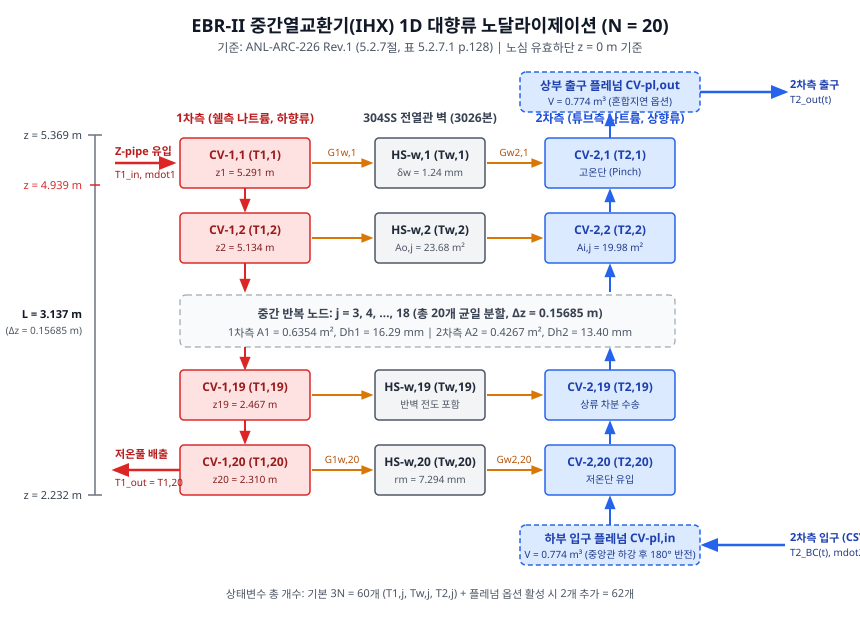

# EBR-II 중간열교환기(IHX) 1D 모델 설계서

기준 자료: `ANL-ARC-226 Rev.1` (인쇄 페이지 기준), `SAS4A/SASSYS-1` 매뉴얼(`ANL/NE-16/19` Ch.12), `ANL-75-55`

---

## 1. IHX가 하는 일과 구조 (`ANL-ARC-226` 5.2.7절, p.124~128)

EBR-II의 IHX는 원자로 노심에서 데워진 **1차측 나트륨**의 열을 **2차측(중간 루프) 나트륨**으로 넘겨주는 직관형 쉘앤튜브 열교환기다. 두 유체가 서로 반대 방향으로 흐르는 **대향류(Counter-flow)** 구조다.

- **1차측 (쉘측, 튜브 바깥, 위 → 아래)**: Z-pipe(높이 $4.939\text{ m}$)로 들어온 뜨거운 나트륨이 3,026개 튜브 바깥을 타고 내려가며 식은 뒤, 하단 출구를 통해 저온풀(Cold Pool)로 나간다.
- **2차측 (튜브 안, 아래 → 위)**: 중앙 입구관으로 바닥까지 내려간 차가운 나트륨이 하부 플레넘에서 $180^\circ$ 돌아 3,026개 튜브 안을 타고 올라오며 데워진 뒤, 상부 플레넘을 거쳐 빠져나간다.
- **자연순환 역할**: IHX가 노심보다 약 $2 \sim 5\text{ m}$ 위에 있기 때문에, 펌프가 꺼진 뒤에도 IHX에서 차갑게 식어 무거워진 나트륨이 아래로 가라앉으며 전체 1차계통 자연순환을 일으킨다.

### 주요 치수 (`ihx_geometry.json`, 표 5.2.7.1 p.128)

| 구분 | 항목 | 값 | 출처 및 비고 |
|---|---|---|---|
| 사양서 원값 | 튜브 수 $N_t$ / 길이 $L$ | 3,026개 / 3.137 m | 표 5.2.7.1, p.128 |
| 사양서 원값 | 튜브 외경 $D_o$ / 두께 $\delta_w$ / 내경 $D_i$ | 15.88 / 1.24 / 13.40 mm | 표 5.2.7.1, p.128 (재질: 304SS) |
| 사양서 원값 | 튜브 피치 $P$ ($P/D_o$) | 20.64 mm (약 1.30) | 표 5.2.7.1, p.128 (삼각 배열) |
| 사양서 원값 | 웰 케이싱 내경 / 2차측 중앙관 외경 | 1.295 m / 0.324 m | 표 5.2.7.1, p.128 |
| 사양서 원값 | 2차측 입구, 출구 플레넘 부피 | 각 0.774 $\text{m}^3$ | 표 5.2.7.1, p.128 |
| 높이 정보 | 튜브 하단 ~ 상단 높이 ($z=0$: 노심 하단) | 2.232 ~ 5.369 m | 그림 5.2.7.3, p.127 (**확인 필요**, 차이 3.137 m 일치) |
| 높이 정보 | 1차측 입구 창 ~ 출구 창 높이 (유효 전열길이) | 4.939 ~ 2.372 m ($L_{\text{eff}} = 2.567\text{ m}$) | 입구: 5.2.7절 p.124, 출구: 그림 5.2.7.3 판독 (**확인 필요**) |
| 파생 계산값 | 전열면적 (외측 $A_{ht,o}$ / 내측 $A_{ht,i}$) | 387.52 / 327.00 $\text{m}^2$ (active), 473.57 / 399.61 $\text{m}^2$ (full) | $N_t \pi D L$ |
| 파생 계산값 | 1차측(쉘) 유동면적 $A_1$ / 수력직경 $D_{h,1}$ | 0.63536 $\text{m}^2$ / 16.29 mm | 중앙관이 번들을 관통한다고 **가정** |
| 파생 계산값 | 2차측(튜브) 유동면적 $A_2$ / 수력직경 $D_{h,2}$ | 0.42674 $\text{m}^2$ / 13.40 mm | 3,026개 튜브 내측 합산 |

---

## 2. 노달라이제이션 (Nodalization)

열교환 구간을 위에서 아래로 똑같이 **$N = 80$층**으로 나눈다 (`ihx.py` 기본값 `DEFAULT_N_NODES = 80`).

- **열교환 구간 (`length_mode`)**: 기본값 `"active"`는 1차측 입구 창(4.939 m)부터 출구 창(2.372 m)까지 **2.567 m** ($\Delta z = 0.03209\text{ m}$)를 쓴다. 입구 위쪽은 상부 관판으로 막혀 1차측 유동이 거의 없기 때문이다. 비교용 `"full"`은 튜브 전체 3.137 m (2.232~5.369 m)를 쓴다.
- **왜 80층인가**: NTU가 7.7(active)로 커서 1차 상류 차분의 수치 확산이 크다. $N = 20$에서는 열량이 격자 수렴값보다 약 2.9% 작고, $N = 80$이면 약 0.7% 이내로 들어온다 (5번 문서 4.1절, $\varepsilon$-NTU 해석해 대조 포함). 계산 시간은 정상상태 0.1초 미만, 900 s 과도 한 케이스 약 3~4초다.
- 아래 노달라이제이션 그림은 구조를 보여 주기 위해 20층으로 그렸다. 층 수만 다르고 구조는 같다.

- **층 번호 규약**: 맨 위층(1차측 입구, 2차측 출구)이 1번, 맨 아래층(1차측 출구, 2차측 입구)이 $N$번이다. (파이썬 코드 배열 인덱스는 `0` ~ `N-1`)
- 한 층($j$)마다 나란히 **3개의 온도**를 계산한다:
  1. $T_{1,j}$: 1차측 나트륨 온도 (위층 $j-1$에서 내려옴)
  2. $T_{w,j}$: 304SS 튜브 벽 온도 (1차측 열을 받아 2차측으로 전달)
  3. $T_{2,j}$: 2차측 나트륨 온도 (아래층 $j+1$에서 올라옴)

| 영역 ID | 설명 | 칸 수 | 1칸 높이 $\Delta z$ | 전체 부피 (active) |
|---|---|---|---|---|
| `CV-1,1` ~ `N` | 1차측 쉘 나트륨 (하향류) | 80 | 0.03209 m | 1.631 $\text{m}^3$ |
| `HS-w,1` ~ `N` | 304SS 튜브 벽 (3,026본 합산) | 80 | 0.03209 m | 0.443 $\text{m}^3$ |
| `CV-2,1` ~ `N` | 2차측 튜브 나트륨 (상향류) | 80 | 0.03209 m | 1.095 $\text{m}^3$ |
| `CV-pl,in`, `out` | 2차측 하부, 상부 플레넘 (선택 옵션) | 각 1 | 0D 혼합 방 | 각 0.774 $\text{m}^3$ |

---

## 3. 지배방정식 (에너지 보존식)

과도 상태(사고 진행 중)에서는 유량과 온도가 매초 변하므로 정상상태 공식인 LMTD를 쓸 수 없다. 대신 각 층마다 **[저장 에너지 변화율 = 들어온 열 - 나간 열]** 식을 세운다.

1. **1차측 나트륨 ($j$층)**: 위에서 들어온 열 - 아래로 나간 열 - 벽으로 뺏긴 열
   $$M_{1,j} c_{p,1,j} \frac{dT_{1,j}}{dt} = \dot{m}_1 c_{p,1,j}\left(T_{1,j-1} - T_{1,j}\right) - G_{1w,j}\left(T_{1,j} - T_{w,j}\right)$$
2. **304SS 튜브 벽 ($j$층)**: 1차측에서 받은 열 - 2차측으로 넘긴 열
   $$M_{w,j} c_{p,w,j} \frac{dT_{w,j}}{dt} = G_{1w,j}\left(T_{1,j} - T_{w,j}\right) - G_{w2,j}\left(T_{w,j} - T_{2,j}\right)$$
3. **2차측 나트륨 ($j$층)**: 아래에서 올라온 열 - 위로 나간 열 + 벽에서 받은 열
   $$M_{2,j} c_{p,2,j} \frac{dT_{2,j}}{dt} = \dot{m}_2 c_{p,2,j}\left(T_{2,j+1} - T_{2,j}\right) + G_{w2,j}\left(T_{w,j} - T_{2,j}\right)$$

### 왜 벽 전도 저항을 반씩 나눠 넣었나?
액체 나트륨은 열전달이 워낙 잘 돼서, **IHX 전체 열저항의 약 56%가 1.24 mm 두께의 스테인리스 튜브 벽 자체**에서 생긴다(1차측 대류 18%, 2차측 대류 26%). 그래서 벽 중심($r_m = \sqrt{r_o r_i}$)을 기준으로 바깥쪽 반벽 저항과 안쪽 반벽 저항을 각각 $G_{1w,j}$, $G_{w2,j}$에 포함시켰다:
$$G_{1w,j} = \left[ \frac{1}{h_{1,j} A_{o,j}} + \frac{\ln(r_o / r_m)}{2 \pi k_{w,j} \Delta z N_t} \right]^{-1}, \qquad G_{w2,j} = \left[ \frac{\ln(r_m / r_i)}{2 \pi k_{w,j} \Delta z N_t} + \frac{1}{h_{2,j} A_{i,j}} \right]^{-1}$$
이렇게 하면 정상상태 원통 열전도 공식과 오차 없이 100% 일치한다.

---

## 4. 물성치 및 열전달 상관식

### 4.1 물성치 수식 ($T$ 단위: K)

- **액체 나트륨 (`SAS4A/SASSYS-1` Ch.12, `ANL/NE-16/19`, 팀 공통 밀도식과 동일 세트)**
  - 밀도 $\rho_{\text{Na}} = 1004.23 - 0.21390\,T - 1.1046\times 10^{-5}\,T^2$ $[\text{kg/m}^3]$ (식 12.13-5)
  - 비열 $c_{p,\text{Na}} = 1972.0 - 2.4560\,T + 3.0921\times 10^{-3}\,T^2 - 1.7191\times 10^{-6}\,T^3 + 3.7782\times 10^{-10}\,T^4$ $[\text{J/(kg K)}]$
  - 열전도도 $k_{\text{Na}} = 110.45 - 6.5112\times 10^{-2}\,T + 1.5430\times 10^{-5}\,T^2 - 2.4617\times 10^{-9}\,T^3$ $[\text{W/(m K)}]$
  - 점성계수 $\mu_{\text{Na}} = 3.6522\times 10^{-5} + 0.16626/T - 45.6877/T^2 + 2.8733\times 10^4/T^3$ $[\text{Pa s}]$
- **304 스테인리스강 (`ANL-75-55`, 팀 내 다른 식이 없으면 기본 사용 - 확인 필요)**
  - 밀도 $\rho_{304} = 7984.1 - 0.26506\,T - 1.1580\times 10^{-4}\,T^2$ $[\text{kg/m}^3]$
  - 비열 $c_{p,304} = 469.44 + 0.13481\,T$ $[\text{J/(kg K)}]$
  - 열전도도 $k_{304} = 8.116 + 0.01618\,T$ $[\text{W/(m K)}]$

### 4.2 열전달 상관식 선정과 저유량($\text{Pe}$) 점검

사고가 나면 유량이 정격의 약 5~6%까지 줄어들어 페클레 수($\text{Pe} = \text{Re}\,\text{Pr}$)가 정격 약 $170 \sim 204$에서 **저유량 약 $6 \sim 20$** 까지 떨어진다.

| 위치 | 채택 상관식 (기본) | 수식 ($x = P/D_o = 1.30$) | 선정 이유 및 저유량 점검 |
|---|---|---|---|
| **1차측 (쉘측 봉다발)** | **Mikityuk (2009)** | $\text{Nu} = 0.047\left[1 - e^{-3.8(x-1)}\right]\left(\text{Pe}^{0.77} + 250\right)$ | 삼각 배열 봉다발 액체금속 식 (`Nucl. Eng. Des. 239`). 개발 데이터 범위가 $\text{Pe} \ge 30$ 정도라 저유량에서는 외삽이다. $\text{Pe}=10$에서 $\text{Nu}=8.18$로, 비교 식 **Ushakov** ($\text{Nu}=9.31$), **Schad-modified** ($\text{Nu}=8.31$)와 비슷한 값을 준다. |
| **2차측 (튜브 원형관)** | **Seban-Shimazaki (1951)** | $\text{Nu} = 5.0 + 0.025\,\text{Pe}^{0.8}$ | 원형관 난류 액체금속 식으로, **벽온도 일정** 조건에서 유도되었다. 비교 식 **Lyon-Martinelli** ($7 + 0.025\,\text{Pe}^{0.8}$)는 **열유속 일정** 조건 식이다. 대향류 IHX의 벽 조건은 두 경우 사이에 있으므로 보수적으로 작은 쪽(Seban)을 기본으로 두고 Lyon은 민감도로 본다 (열량 차이 약 0.5%). |

(`ihx.py` 코드에는 비교를 위해 `ushakov`, `schad`, `lyon` 옵션도 모두 넣어 두었다.)

**저유량 한계 (확인 필요)**: 유량이 정격의 5% 안팎으로 떨어지면 튜브측 Re가 약 2,000 이하로 내려가 층류 영역에 들어간다. 위 난류 식들은 Pe → 0에서도 Nu ≥ 5를 주지만, 원형관 층류 완전발달값은 Nu = 3.66(벽온도 일정) ~ 4.36(열유속 일정)이다. 다만 튜브 벽 전도 저항이 전체 열저항의 절반 이상이라, Nu를 5 → 4로 바꿔도 전체 열전달계수 변화는 이보다 훨씬 작다. 저유량 구간을 따로 다룰지는 과도 검증 결과를 보고 정한다.

---

## 5. 수치 계산 방법 (왜 안정적인가?)

- **공간 차분 (1차 상류 차분)**: 유체가 흘러오는 쪽(1차측은 위칸, 2차측은 아래칸) 온도를 받아 계산하므로 온도가 출렁거리는 수치 진동이 생기지 않는다.
- **시간 적분 (반음해 후방 오일러법)**: 튜브 벽이 얇아서 반응 시간($\tau_w \approx 0.066\text{ s}$)이 매우 짧다. 단순 양해법(Explicit)을 쓰면 시간간격 $\Delta t$를 $0.04\text{ s}$보다 작게 잡아야 안 터지지만, 다음 스텝 온도 $3N$개(기본 240개)를 연립방정식으로 한 번에 푸는 **음해법(Implicit)** 을 써서 $\Delta t$를 크게 잡아도 절대 발산하지 않고 에너지가 정확히 보존된다.
- **권장 시간간격**: 펌프가 빠르게 도는 초반($0 \sim 100\text{ s}$)은 $\Delta t = 0.05 \sim 0.1\text{ s}$, 이후 자연순환 구간($100 \sim 900\text{ s}$)은 $\Delta t = 0.1 \sim 0.5\text{ s}$면 충분하다.

---

## 6. 팀원들과 확인만 맞추면 되는 항목

1. **304SS 물성식**: 노심이나 Z-pipe 파트에서 쓰는 스테인리스강 물성식이 따로 있으면 거기에 맞춘다 (없으면 `ANL-75-55` 그대로 사용).
2. **IHX 압력손실 계수($K_{\text{form}}$)**: 루프 운동량 파트에서 초기 유량 맞출 때 설정한 IHX 국부 손실계수가 있으면 `create_ihx(k_form_shell=...)`에 넣으면 된다.
