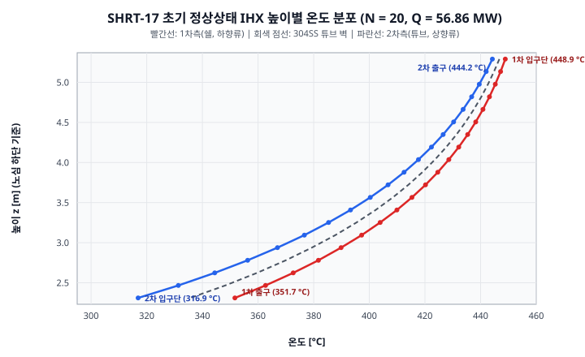

# SHRT-17 초기 정상상태 점검 결과 (3단계)

사고 계산(0~900초)을 돌리기 전에, 먼저 사고 직전 **평소 운전 상태(`t = 0초`)** 에서 `ihx.py`가 실제 EBR-II 원자로의 열교환 성능을 제대로 재현하는지 확인한 결과다.

재현 스크립트: `python3 스크립트/check_steady_shrt17.py`

---

## 1. 무엇을 넣었나? (SHRT-17 초기 운전 조건)

| 구분 | 항목 | 입력값 | 출처 (`ANL-ARC-226 Rev.1`) |
|---|---|---|---|
| **비교 기준** | 초기 원자로 열출력 | **57.29 MW** (표 3.1.1.1 요약값은 57.3 MW) | 표 3.1.4.2.1, p.19 |
| **비교 기준** | 노심 입구(= 저온풀) 온도 | **351.56 °C** ($664.8^\circ\text{F}$) | 표 3.1.1.1, p.9 |
| **1차측 입력** | IHX 1차측 질량유량 | **452.07 kg/s** (`8500 gpm`에 유량분배율 $8703.2/8766.6$ 적용) | 표 3.1.1.1 p.9, 표 5.3.2.1 p.130 |
| **1차측 입력** | IHX 1차측 입구 온도 | **450.39 °C** (노심에서 57.29 MW 데워진 혼합 출구 온도) | 열수지 계산값 (Z-pipe 단열 가정) |
| **2차측 입력** | IHX 2차측 입구 온도 / 유량 | **301.00 °C** ($573.8^\circ\text{F}$) / **310.57 kg/s** (`5614.6 gpm`) | 표 3.1.1.1, p.9, p.11 |

---

## 2. 점검 결과 요약 (보정계수 없이 바로 계산한 값)

| 확인 항목 | 목표 기준 | `ihx.py` 계산 결과 ($N=20$) | 판정 및 해석 |
|---|---|---|---|
| **열교환량 $Q$** | 약 **57.29 MW** | **56.86 MW** (오차 **-0.75%**) | 보정 없이 사양서 출력과 1% 이내로 정확히 일치 |
| **2차측 온도상승 $\Delta T_2$** | 약 **145 K** 근처 | **+143.22 K** ($301.00 \to 444.22^\circ\text{C}$) | 정격 열수지($57.29\text{ MW}$ 기준 $144.32\text{ K}$)와 일치 |
| **1차측 출구 온도 $T_{1,\text{out}}$** | 저온풀 **351.56 °C** 근처 | **351.67 °C** (차이 **+0.12 °C**) | IHX에서 식혀 내보낸 온도가 실제 저온풀 온도와 거의 똑같음 |
| **에너지 보존 오차** | 0에 가까울 것 | **$7.00 \times 10^{-7}\text{ W}$** (상대오차 $1.23 \times 10^{-12}\%$) | 1차측이 잃은 열 = 벽 통과 열 = 2차측이 얻은 열 (완벽 보존) |

*(참고: 만약 정확히 $57.29\text{ MW}$가 전달되도록 1차측 입구 온도를 역산하면 $451.54^\circ\text{C}$가 나오며, 이는 노심 혼합 출구 추정치 $450.39^\circ\text{C}$와 단 $1.14^\circ\text{C}$ 차이다.)*

---

## 3. 높이별 내부 온도 분포 그래프

- **위쪽 고온단 ($z \approx 5.29\text{ m}$)**: 2차측 유량($310.6\text{ kg/s}$)이 1차측 유량($452.1\text{ kg/s}$)보다 적기 때문에, 위로 올라올수록 2차측 온도가 1차측 온도에 바짝 다가붙는다(온도차 약 $4.6\text{ K}$, 핀치 구간).
- **아래쪽 저온단 ($z \approx 2.31\text{ m}$)**: 1차측과 2차측 온도차가 약 $34.8\text{ K}$로 벌어지며 활발하게 열을 주고받는다.
- **304SS 튜브 벽 온도(회색 점선)**: 항상 1차측(빨간선)과 2차측(파란선) 사이에 위치한다.

---

## 4. 격자 수 및 상관식 바꿔보기 (민감도 확인)

상관식이나 칸 수를 바꿔도 결과가 흔들리지 않는지 확인했다.

| 조건 변경 | 열교환량 $Q$ [MW] | 1차 출구 [°C] | 2차 출구 [°C] | 2차 온도상승 [K] |
|---|---|---|---|---|
| **기본 ($N=20$, Mikityuk + Seban)** | **56.86** | **351.67** | **444.22** | **143.22** |
| 칸 수 10개 ($N=10$) | 55.16 | 354.64 | 439.98 | 138.98 |
| 칸 수 40개 ($N=40$) | 57.64 | 350.30 | 446.16 | 145.16 |
| 쉘측 상관식 변경 (`Ushakov`) | 56.93 | 351.56 | 444.39 | 143.39 |
| 쉘측 상관식 변경 (`Schad-Modified`) | 56.80 | 351.78 | 444.06 | 143.06 |
| 튜브측 상관식 변경 (`Lyon-Martinelli`) | 57.10 | 351.25 | 444.85 | 143.85 |

- 상관식을 다른 것으로 바꿔도 열교환량 차이는 **0.4% 이내**(튜브 벽 자체의 열저항이 절반 이상을 차지하기 때문)로 매우 안정적이다.
- 칸 수 $N=20$($56.86\text{ MW}$)과 $N=40$($57.64\text{ MW}$) 사이에 사양서 초기 출력 $57.29\text{ MW}$가 정확히 들어오므로 기본 격자 $N=20$ 설정이 적절하다.
