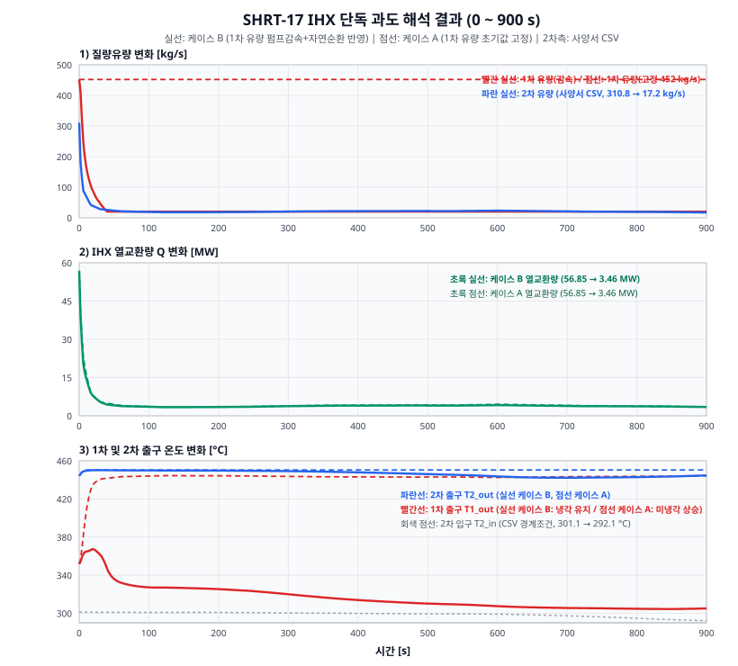

# SHRT-17 IHX 단독 과도 계산 결과 (4단계, 0 ~ 900 s)

펌프가 정지된 직후(`0초`)부터 자연순환이 자리 잡는 `900초(15분)`까지 IHX가 어떻게 반응하는지 `ihx.py`로 단독 시뮬레이션한 결과다.

- 실행 명령어: `python3 스크립트/run_transient_shrt17.py`
- 나중에 실측 디지타이징 CSV나 Z-pipe 출력 CSV가 생기면 바로 넣는 명령어:
  `python3 스크립트/run_transient_shrt17.py --primary-csv <파일경로.csv>`

---

## 1. 어떤 조건으로 돌렸나?

- **2차측 (실제 실험 경계조건 CSV 그대로 입력)**:
  - 유량(`bc_ihx_secondary_flow_SHRT17.csv`, 표 3.1.4.2.1 p.21): $0\text{ s}$에 $310.84\text{ kg/s}$에서 출발해 펌프 정지 후 급격히 줄어들어 $900\text{ s}$에는 정격의 약 $5.5\%$인 **$17.20\text{ kg/s}$** 까지 감소한다.
  - 입구 온도(`bc_ihx_secondary_temp_SHRT17.csv`, 표 3.1.4.2.2 p.21): $301.12^\circ\text{C} \to 292.13^\circ\text{C}$로 서서히 내려간다.
- **1차측 (아직 전체 루프와 합치기 전이므로 두 가지 비교 케이스로 계산)**:
  1. **케이스 A (점선, 1차 유량 초기값 고정)**: 1차 입구 온도($450.39^\circ\text{C}$)와 1차 유량($452.07\text{ kg/s}$)을 고정해 두고, 오직 **2차측 유량이 줄어드는 영향만** 따로 본 기준선.
  2. **케이스 B (실선, 1차 펌프 감속 + 자연순환 반영)**: 1차 입구 온도는 $450.39^\circ\text{C}$로 두되, 1차 유량이 실제 펌프 회전수 CSV(`bc_pump_speed_SHRT17.csv`, 표 3.1.4.1.1 p.14)를 따라 줄어든 뒤 약 $4.5\%$($20.34\text{ kg/s}$, **가정**) 자연순환 유량으로 흐르는 현실적 조건.

---

## 2. 0 ~ 900초 과도 응답 그래프

---

## 3. 시간에 따른 주요 수치 요약

| 시각 [s] | 2차측 유량 [kg/s] | 케이스 A: 열량 [MW] / 1차 출구 [°C] / 2차 출구 [°C] | 케이스 B: 1차 유량 [kg/s] / 열량 [MW] / 1차 출구 [°C] / 2차 출구 [°C] |
|---|---|---|---|
| **0** | 310.84 | 56.85 / 351.69 / 444.20 | 452.07 / **56.85** / **351.69** / **444.20** |
| **5** | 107.76 | 26.81 / 374.85 / 448.94 | 281.68 / **24.10** / **360.60** / **448.44** |
| **15** | 48.64 | 10.77 / 425.22 / 450.38 | 117.66 / **10.28** / **365.78** / **449.95** |
| **30** | 28.27 | 5.49 / 440.46 / 450.39 | 47.29 / **5.43** / **361.51** / **450.19** |
| **50** | 23.58 | 4.50 / 442.48 / 450.39 | 20.34 / **4.12** / **336.08** / **450.05** |
| **100** | 19.18 | 3.64 / 444.02 / 450.39 | 20.34 / **3.54** / **327.21** / **449.87** |
| **300** | 20.53 | 3.91 / 443.58 / 450.39 | 20.34 / **3.78** / **319.95** / **449.17** |
| **600** | 23.50 | 4.51 / 442.53 / 450.39 | 20.34 / **4.19** / **307.48** / **443.61** |
| **900** | 17.20 | 3.46 / 444.35 / 450.39 | 20.34 / **3.46** / **305.15** / **444.65** |

- 900초 전 구간(총 2,600 스텝) 동안 최대 에너지 보존 오차는 **$3.73 \times 10^{-6}\text{ W}$** 로 수치 발산이나 열 손실 없이 완벽히 계산되었다.

---

## 4. 물리적으로 무엇을 알 수 있나? (쉬운 해석)

1. **열교환량 $Q$의 급감 ($56.85 \to 3.46\text{ MW}$)**: 2차측 유량이 정격의 5.5% 수준으로 떨어지면, 2차측이 받아갈 수 있는 열용량 한계 때문에 IHX 열제거량도 약 $3.5 \sim 4.5\text{ MW}$ 수준으로 줄어든다. SHRT-17은 스크램(원자로 정지)이 동시에 일어나 노심 출력도 붕괴열($1 \sim 3\text{ MW}$)로 줄어들기 때문에 이 정도 열제거만으로도 충분히 노심을 식힐 수 있다.
2. **왜 1차측 유량도 같이 줄어야 자연순환이 되나? (케이스 A vs 케이스 B)**:
   - 만약 1차 유량이 안 줄어드는 **케이스 A(빨간 점선)** 라면, 많은 1차 나트륨이 열을 거의 못 뺏긴 채 $444^\circ\text{C}$의 뜨거운 상태로 그대로 빠져나간다.
   - 반면 실제 원자로처럼 1차 펌프도 같이 멈추는 **케이스 B(빨간 실선)** 에서는, 천천히 내려오는 1차 나트륨이 IHX 안에서 충분히 식어 **$305 \sim 336^\circ\text{C}$의 차갑고 무거운 나트륨**이 되어 아래로 가라앉는다. 이것이 바로 펌프 없이도 냉각재를 계속 돌게 만드는 **자연순환의 원동력(부력)** 이다.
