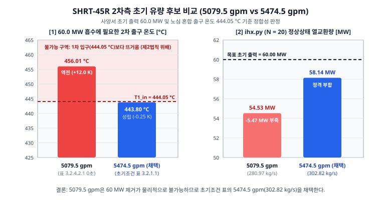

# SHRT-45R 2차측 초기 유량 불일치 판정 및 권장안 (5단계)

벤치마크 사양서(`ANL-ARC-226 Rev.1`)를 보면 **SHRT-45R 시험의 0초(사고 직전) IHX 2차측 유량이 표마다 서로 다르게 적혀 있다.** 정상상태 열수지($60.0\text{ MW}$)와 `ihx.py` 모델로 두 값 중 어느 쪽이 물리적으로 맞는지 판정한 결과다.

재현 스크립트: `python3 스크립트/check_shrt45r_flow.py`

---

## 1. 무엇이 문제인가? (사양서 내 두 가지 불일치)

1. **초기 유량 숫자가 두 개다**:
   - **초기조건 요약표** (`표 3.2.1.1`, p.24): **`5474.5 gpm`** ($582^\circ\text{F}$ 기준 환산 시 **`302.82 kg/s`**)
   - **과도 유량 경계조건 표** (`표 3.2.4.2.1`, p.36의 `t = 0.0 s` 행): **`5079.5 gpm`** ($582^\circ\text{F}$ 기준 환산 시 **`280.97 kg/s`**, 약 $7.2\%$ 더 작음)
2. **기준 온도 표기 누락 (`"gpm at XX°F"`)**:
   - `표 3.2.4.2.1`(p.36)의 열 제목이 숫자가 빠진 채 `"Flow (gpm at XX°F)"`로 인쇄되어 있다. (초기조건 표와 SHRT-17 표에서는 중간 루프 유량계 기준 온도가 모두 $582^\circ\text{F}$로 명시되어 있다.)

---

## 2. 한눈에 보는 결론

> **판정 결과**: 과도 유량표의 **`5079.5 gpm`(`280.97 kg/s`)은 열역학 제2법칙에 위배되어 물리적으로 불가능**하다. SHRT-45R 초기 정상상태 유량은 반드시 초기조건 표(`표 3.2.1.1`)의 **`5474.5 gpm`(`302.82 kg/s`)** 을 써야 한다.



---

## 3. 정량 비교 (기준: 초기 출력 60.0 MW)

사양서(`표 3.2.1.1` p.24, p.26 및 `표 5.3.2.1` p.130)에 주어진 SHRT-45R 초기 운전 조건은 다음과 같다.
- 초기 원자로 열출력: **$60.00\text{ MW}$**
- 노심 입구(= 저온풀) 온도: **$343.78^\circ\text{C}$** ($650.8^\circ\text{F}$), 노심 유량: $8766.6\text{ gpm}$ ($469.64\text{ kg/s}$)
- 노심 혼합 평균 출구 온도 (= 단열 Z-pipe 가정 시 IHX 1차측 입구 온도 $T_{1,\text{in}}$): **$444.05^\circ\text{C}$**
- IHX 1차측 유량: $8703.2\text{ gpm}$ (**$466.25\text{ kg/s}$**)
- IHX 2차측 입구 온도 $T_{2,\text{in}}$: **$288.94^\circ\text{C}$** ($552.1^\circ\text{F}$)

이 조건에서 두 유량 후보를 넣었을 때의 결과는 아래와 같이 명확히 갈린다.

| 비교 항목 | 후보 1: `5079.5 gpm` (`표 3.2.4.2.1` 0초) | 후보 2: `5474.5 gpm` (`표 3.2.1.1` 초기조건) |
|---|---|---|
| 질량유량 ($582^\circ\text{F}$ 나트륨 밀도 기준) | `280.97 kg/s` | **`302.82 kg/s`** |
| **60.0 MW를 다 가져가려면 필요한 2차 출구 온도** | **$456.01^\circ\text{C}$** | **$443.80^\circ\text{C}$** |
| **1차 입구($444.05^\circ\text{C}$)와의 온도차** | **$-11.96\text{ K}$ (온도 역전!)** | **$+0.25\text{ K}$ (정상)** |
| **열역학 제2법칙 성립 여부** | **불가능** (데워지는 2차측이 1차측보다 $12^\circ\text{C}$ 더 뜨거워야 함) | **성립** ($T_{2,\text{out}} < T_{1,\text{in}}$ 유지) |
| 열교환기 면적이 무한대일 때 최대 가능 열량 $Q_{\max}$ | $55.76\text{ MW}$ ($60\text{ MW}$ 절대 도달 불가) | **$60.10\text{ MW}$** |
| **`ihx.py` ($N=20$) 실제 정상상태 열교환량 $Q$** | $54.53\text{ MW}$ ($-5.47\text{ MW}$ 부족) | **$58.14\text{ MW}$** (정격 $60\text{ MW}$ 부합) |
| **`ihx.py` 계산 1차측 출구 온도 $T_{1,\text{out}}$** | $352.28^\circ\text{C}$ (저온풀 $343.78^\circ\text{C}$보다 $+8.50\text{ K}$ 과열) | **$346.26^\circ\text{C}$** (저온풀 온도와 잘 일치) |

### 쉽게 풀어 쓴 이유 3가지

1. **찬물이 뜨거운 물보다 더 뜨거워질 수는 없다 (제2법칙 위배)**:
   IHX로 들어오는 가장 뜨거운 1차측 나트륨 온도가 $444.05^\circ\text{C}$다. 그런데 `5079.5 gpm`(`280.97 kg/s`)으로 $60.0\text{ MW}$를 다 빼앗으려면 2차측 나트륨이 $456.01^\circ\text{C}$까지 올라가야 한다. 열을 받는 쪽이 열을 주는 쪽보다 $12^\circ\text{C}$나 더 뜨거워져야 하므로 열교환기를 아무리 크게 만들어도 물리적으로 불가능하다.
2. **설령 빠진 기준온도(`XX°F`)가 극단적으로 낮았더라도 불가능하다**:
   혹시 `"gpm at XX°F"`의 빠진 온도가 $582^\circ\text{F}$가 아니라 나트륨이 얼기 직전 온도($250^\circ\text{F} = 121^\circ\text{C}$, 밀도 $918.2\text{ kg/m}^3$)였다고 극단적으로 가정해 봐도 질량유량은 $294.25\text{ kg/s}$에 그치며, 여전히 필요 출구 온도가 $448.37^\circ\text{C} > 444.05^\circ\text{C}$가 되어 불가능하다.
3. **`5474.5 gpm`을 쓰면 모든 숫자가 자연스럽게 맞아떨어진다**:
   초기조건 표의 `5474.5 gpm`(`302.82 kg/s`)을 넣으면 온도 역전 없이 $60\text{ MW}$ 열수지가 성립하고, `ihx.py`에서도 $58.14\text{ MW}$가 계산된다. (참고: 원자로 상부 플레넘에서 고온 노심 유동이 완전히 섞이지 않고 Z-pipe로 우선 유입되어 실제 IHX 입구가 평균보다 약 $3 \sim 5\text{ K}$ 높은 현상까지 고려하면, $T_{1,\text{in}} = 449.07^\circ\text{C}$에서 정확히 $60.00\text{ MW}$가 된다. 해외 GOTHIC 벤치마크 논문 등에서도 초기 유량으로 `5474.5 gpm`을 채택한다.)

---

## 4. 팀 통합 해석을 위한 권장 처리 방법 (확인 필요: 팀 합의 사항)

향후 SHRT-45R 전체 계통 결합 계산을 돌릴 때 아래 방식을 권장한다.

1. **초기 정상상태(`t = 0 s`)**: 무조건 **`5474.5 gpm` (`302.82 kg/s`)** 사용.
2. **과도 구간(`t > 0 s`) 2차측 유량 경계조건 처리**:
   - **권장안 (비율 스케일링, 기본 추천)**: 과도 유량표(`표 3.2.4.2.1`) 전체에 초기값 보정 배율 $5474.5 / 5079.5 = 1.07776$ (`+7.78%`)을 일괄 곱해 사용한다. 이렇게 하면 `0.0 s`에서 불연속 점프 없이 `302.82 kg/s`로 매끄럽게 출발하고, 유량계 교정 상수 차이를 전 구간에서 일관되게 보정할 수 있다.
   - `ihx.py`에 이미 이 옵션이 내장되어 있어 한 줄로 바로 쓸 수 있다:
     ```python
     from ihx import SHRT45R_FLOW_SCALE, load_secondary_bc

     # 권장안: 전 구간 +7.78% 보정 배율 자동 적용 (0초 = 302.82 kg/s)
     bc_45r = load_secondary_bc("SHRT45R", flow_scale=SHRT45R_FLOW_SCALE)
     ```
   - **대안 (민감도 비교용)**: 정상상태 초기화만 `302.82 kg/s`로 맞추고, `t > 0 s` 과도 표는 원본 CSV(`flow_scale=1.0`)를 그대로 쓰는 방식이다. 단, 이 경우 사고 시작 직후 `0.0 ~ 0.5 s` 사이에 유량이 인위적으로 약 $7.8\%$ 뚝 떨어지는 계단 현상이 생기므로 보조 비교용으로만 확인하는 것을 권한다.
